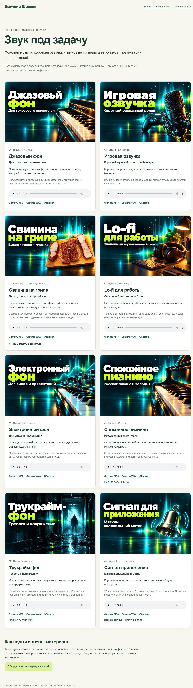
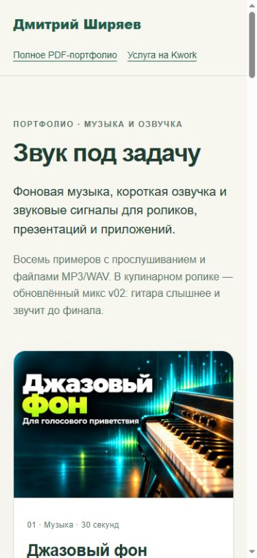

# Музыка и озвучка

Восемь аудиокейсов Дмитрия Ширяева. [Исходник HTML-витрины](index.html) · [Полное PDF-портфолио](../portfolio.pdf) · [Kwork](https://kwork.ru/audio/55227642/podgotovlyu-muzyku-i-ozvuchku-dlya-vashego-rolika)

| Работа | Длительность | MP3 | WAV |
|---|---|---|---|
| Джазовый фон | 30 секунд | [Слушать](media/01-jazz.mp3) | [Скачать](media/01-jazz.wav) |
| Игровая озвучка | 5,4 секунды | [Слушать](media/02-voice.mp3) | [Скачать](media/02-voice.wav) |
| Свинина на гриле | 30 секунд · версия v02 | [Слушать](media/03-bbq.mp3) | [Скачать](media/03-bbq.wav) |
| Lo-fi для работы | Около минуты | [Слушать](media/04-lofi.mp3) | [Скачать](media/04-lofi.wav) |
| Электронный фон | 28,9 секунды | [Слушать](media/05-electronic.mp3) | [Скачать](media/05-electronic.wav) |
| Спокойное пианино | 60 секунд | [Слушать](media/06-piano.mp3) | [Скачать](media/06-piano.wav) |
| Трукрайм-фон | 60 секунд | [Слушать](media/07-true-crime.mp3) | [Скачать](media/07-true-crime.wav) |
| Сигнал приложения | 6 секунд | [Слушать](media/08-notification.mp3) | [Скачать](media/08-notification.wav) |

## Третий ролик
[MP4 v02](media/03-bbq-v02.mp4): фон заметнее под голосом, музыка звучит все30секунд. Видеоряд сохранён без перекодирования.

## Состав
Витрина работает без сборки: index.html и style.css. Все аудиоплееры загружают звук только по действию пользователя. В media находятся MP3/WAV, полные MP3-версии6–7, полный сигнал и тест повторов8, а также MP4 третьего кейса. covers содержит PNG и оптимизированные WebP.

Для локального просмотра: python -m http.server 8000 из корня репозитория, затем /audio/.

Музыка и синтез речи созданы с использованием ИИ и последующей обработкой. Публикация в портфолио не предоставляет автоматически лицензию на повторное или коммерческое использование; условия согласуются отдельно. Черновики, проекты Audacity, модели и доступы не включены.

## Скриншоты витрины

Снимки проверенной локальной HTML-витрины: восемь карточек, аудиоплееры, загрузка MP3/WAV и ролик v02. Отдельная публикация этой страницы на Vercel пока не выполнена.

Для просмотра скачайте репозиторий и выполните из его корня `python -m http.server 8173`, затем откройте `http://localhost:8173/audio/`.
